# 🔬 EpiScope — Big Data Disease Surveillance & Response Platform

<p align="center">
  
  
  
  
  
  
</p>

<p align="center">
  <b>A reproducible, district-level epidemic intelligence platform for Bangladesh.</b><br>
  Combines clinical encounters, climate data, facility registries, and supply logistics to power early outbreak detection, predictive forecasting, and mathematical emergency resource allocation.
</p>

<p align="center">
  <a href="https://episcope-m.vercel.app/">
    
  </a>
</p>

---

## 🌟 Key Capabilities at a Glance

* 📊 **Big Data Medallion Architecture:** Scalable PySpark pipeline ingesting, cleaning, validating, and aggregating over **6,000,000+** encounter records across all **64 districts** of Bangladesh.
* 🚨 **Automated Outbreak Detection:** CDC **EARS C2** aberration detection paired with **CUSUM** cumulative sum scoring for early signal identification.
* 📈 **Predictive Horizon Forecasting:** 1–4 week ahead **SARIMA** modeling with 95% confidence bounds to forecast disease transmission and bed demand.
* ⚖️ **Equitable Resource Allocation:** Linear programming optimization using **PuLP** and the **CBC solver** to balance district equity and logistical efficiency under constrained national budgets.
* 🗓️ **Seasonal Preparedness Calendar:** Historical risk stratification (`routine`, `prepare`, `peak`) delivering proactive pre-positioning triggers for vector control and health facilities.
* 🔒 **Built-in Privacy & Governance:** Spark-native **salted SHA-256 pseudonymization** for patient IDs (`PRV-1`) and **small-cell suppression** (`< 5` $\rightarrow$ `-1`) on all analytical marts (`PRV-2`).
* ⚡ **Zero-Latency Static Serving:** Pre-rendered, compressed JSON data layer ($\le 10\text{ MB}$) powering an ultra-responsive, dependency-light D3.js dashboard hosted on Vercel.

---

## 🏗️ Architecture & Pipeline Flow

EpiScope leverages the enterprise **Medallion Data Architecture** to guarantee raw lineage immutability, rigorous data quality enforcement, and secure, aggregate-only downstream consumption:

```mermaid
flowchart TD
    subgraph S["Data Sources (S1 - S6)"]
        S1["S1: ADM2 GeoJSON (64 Districts)"]
        S2["S2: Population Census (BBS)"]
        S3["S3: Open-Meteo Climate Series"]
        S4["S4: 6M+ Encounters (Parquet)"]
        S5["S5: Healthcare Facility Registry"]
        S6["S6: Medical Stock Logistics"]
    end

    subgraph Bronze["Bronze Layer (Raw Ingestion)"]
        B["Ingestion Metadata & Checksums<br/>• _batch_id, _source, _loaded_at<br/>• MD5 file integrity verification"]
    end

    subgraph Silver["Silver Layer (Cleansing & Quality)"]
        SV["Data Cleansing & Validation<br/>• 12 Quality Rules (R01 - R12)<br/>• Salted SHA-256 Patient Hashing<br/>• Automated Quarantine Routing"]
    end

    subgraph Gold["Gold Layer (Analytical Marts)"]
        G1["Epi-Weekly Mart (District × Week × Disease)"]
        G2["Stock-Weekly Mart & Consumption"]
        G3["Small-Cell Suppression (&lt; 5 counts masked)"]
    end

    subgraph Analytics["Analytics & Intelligence Engine"]
        A1["Outbreak Detection<br/>(EARS C2 &amp; CUSUM)"]
        A2["Forecasting<br/>(SARIMA 1-4 Wk Horizon)"]
        A3["Optimisation<br/>(PuLP LP Budget Allocator)"]
        A4["Preparedness<br/>(Seasonal Action Calendar)"]
    end

    subgraph Serving["Serving & Presentation Layer"]
        SR["serving/export.py (Topology-preserved GeoJSON &amp; Compact JSONs)"]
        D3["Interactive D3.js v7 Dashboard<br/>Deployed on Vercel"]
    end

    S --> Bronze
    Bronze --> Silver
    Silver --> Gold
    Gold --> Analytics
    Analytics --> Serving
    Serving --> D3
```



---

## ⚡ Quickstart

### Prerequisites
* **Python:** 3.10+
* **Java:** OpenJDK 11+ (required for Apache Spark / PySpark execution)
* **RAM:** 16GB recommended (8GB minimum)

### 1. Clone & Set Up Environment
```bash
git clone https://github.com/your-username/episcope.git
cd episcope

# Configure environment variables
cp .env.example .env

# Install Python dependencies
pip install -r requirements.txt
```

### 2. Run the Full End-to-End Pipeline
Execute data acquisition, generation, Spark ETL, analytics, and serving export with a single command:
```bash
make all
```

### 3. Launch Local Dashboard
```bash
make dashboard
# Serves dashboard on http://localhost:8000
```

---

## 🔄 Incremental Load & Hidden Test Drops

EpiScope is designed for production reproducibility. When new encounter drops arrive:
1. Drop new parquet or CSV batches into:
   ```bash
   pipeline/bronze/encounters/incremental/
   ```
2. Execute the idempotent incremental loader:
   ```bash
   make run-incremental
   ```
> **Idempotency Guarantee:** Uses dynamic partition overwrite to update affected epi-weeks without producing duplicate records or dirty reads.

---

## 📋 Requirement Traceability Matrix

Every requirement outlined in the project specification maps directly to audited code and documentation:

| Requirement ID | Description | Source File | Report Section |
|---|---|---|---|
| **ING-1** | Raw multi-source bronze ingestion with cryptographic audit stamps | [`pipeline/bronze/ingest.py`](pipeline/bronze/ingest.py) | §4.1 |
| **ING-2** | Silver cleaning, broadcast joins, and type validation | [`pipeline/silver/transform.py`](pipeline/silver/transform.py) | §4.2 |
| **ING-3** | Aggregated gold epidemiological-week analytical marts | [`pipeline/gold/mart.py`](pipeline/gold/mart.py) | §4.3 |
| **ING-4** | Dynamic idempotent partition overwrite for incremental data drops | [`pipeline/silver/incremental.py`](pipeline/silver/incremental.py) | §4.4 |
| **DQ-1..3** | 12 Data Quality rules, automated quarantine, and audit log generation | [`pipeline/quality/rules.py`](pipeline/quality/rules.py) | §4.2 |
| **PRV-1..2**| Salted SHA-256 patient de-identification & small-cell suppression | [`transform.py`](pipeline/silver/transform.py) / [`mart.py`](pipeline/gold/mart.py) | §4.2, §4.3 |
| **AN-1..3** | EARS C2 aberration alerts benchmarked against CUSUM | [`analytics/detection/ears.py`](analytics/detection/ears.py) | §5.1 |
| **AN-4..6** | District-level 1–4 week SARIMA forecasting with 95% intervals | [`analytics/forecast/model.py`](analytics/forecast/model.py) | §5.2 |
| **AN-7** | PuLP linear programming supply allocation under constrained budget | [`analytics/optimise/allocate.py`](analytics/optimise/allocate.py) | §5.3 |
| **VIS-1** | Responsive interactive D3.js v7 dashboard with 4 specialized workspaces | [`dashboard/index.html`](dashboard/index.html) | §7 |

---

## 📂 Repository Directory Layout

```text
episcope/
├── README.md                           # Project landing & developer documentation
├── AI_USAGE.md                         # Transparent AI assistance disclosure
├── Makefile                            # Automated build and pipeline orchestration
├── requirements.txt                    # Pinned Python package specifications
├── vercel.json                         # Vercel zero-configuration static deployment
│
├── generator/                          # Data acquisition & realistic synthetic generators
│   ├── download_s1.py                  # S1: Bangladesh ADM2 district boundaries
│   ├── fetch_s3_weather.py             # S3: Open-Meteo climate history harvester
│   ├── generate_s4_encounters.py       # S4: 6M+ encounter generator with injected outbreaks
│   ├── generate_s5_facilities.py       # S5: Healthcare facility registry synthesizer
│   ├── generate_s6_stock.py            # S6: Medical inventory & logistics generator
│   └── ground_truth_outbreaks.csv      # Outbreak benchmark labels (unseen by detectors)
│
├── pipeline/                           # Big Data PySpark ETL processing engine
│   ├── bronze/                         # Raw ingested data with checksums and lineage
│   ├── silver/                         # Cleaned, de-identified data & quarantine tables
│   ├── gold/                           # Aggregated, privacy-suppressed analytical marts
│   └── quality/                        # 12 Automated quality verification rules
│
├── analytics/                          # Advanced statistical & optimization modeling
│   ├── detection/                      # EARS C2 & CUSUM outbreak aberration detection
│   ├── forecast/                       # 1-4 week SARIMA predictive forecasting models
│   ├── optimise/                       # PuLP / CBC emergency medical supply optimizer
│   └── calendar/                       # Seasonal epidemiology preparedness calendar
│
├── serving/                            # Production export engine (Gold -> compact JSONs)
│   └── export.py                       # Generates optimized payloads for browser rendering
│
├── dashboard/                          # Production Web Application
│   ├── index.html                      # Interactive D3.js v7 single-page visualization
│   └── data/                           # Topology-simplified GeoJSON & privacy-safe JSONs
│
├── orchestration/                      # Benchmarking & performance evaluations
│   └── scale_experiment.py             # PySpark scalability & throughput benchmarking
│
└── docs/                               # Formal academic deliverables
    ├── technical_report.md             # IEEE-format technical methodology report
    ├── policy_brief.md                 # Public health executive briefing & SOP
    └── proposal.md                     # Initial project blueprint & stakeholder analysis
```

---

## 🚀 Deployment (Vercel)

The frontend is packaged as a high-performance static web application in the `dashboard/` folder:

1. Import this repository into [Vercel](https://vercel.com/).
2. Select **Framework Preset:** `Other`.
3. Set **Root Directory:** `./` (the bundled [`vercel.json`](vercel.json) routes traffic to `dashboard/`).
4. Click **Deploy**. No build commands or external environment variables required.

To update data on the live dashboard:
```bash
python serving/export.py
git add dashboard/data/
git commit -m "chore: refresh surveillance snapshot"
git push origin main
```

---

## 📄 Publications & Documentation

* 📑 **[Technical Report](docs/technical_report.md):** Full academic report covering pipeline engineering, statistical formulation, benchmarks, and validation.
* 🏛️ **[Policy Brief](docs/policy_brief.md):** Executive recommendations and guidelines for Ministry of Health stakeholders and emergency planners.
* 🤖 **[AI Usage Disclosure](AI_USAGE.md):** Statement of tools and authorship compliance for CSE4345.

---

<p align="center">
  <sub>Developed for CSE4345 — Big Data Analytics · Built with pride for public health epidemiology.</sub>
</p>
